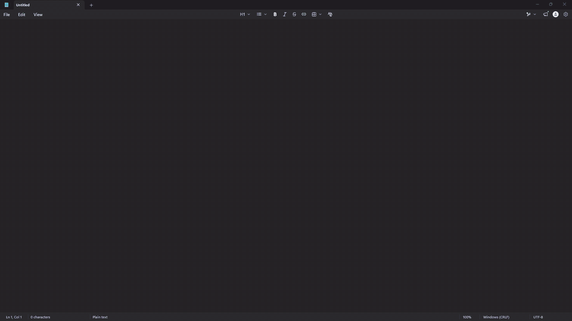

# Turaco


[](https://github.com/digitalblack210/TURACO/actions/workflows/ci.yml)
[](LICENSE)


Offline push-to-talk dictation for Windows, powered by NVIDIA Parakeet.

Hold Ctrl+Win, speak, and release. Turaco transcribes on your own machine and
pastes the text into whatever app has focus. Nothing leaves the computer.



## Requirements

- Windows 11
- Python 3.11 or newer
- Optional: an NVIDIA GPU with a current driver

## Setup

```powershell
git clone https://github.com/digitalblack210/TURACO.git
cd TURACO
py -m venv .venv
.venv\Scripts\pip install -e .
```

The install takes about 2 GB of disk, most of it the NVIDIA CUDA libraries
that GPU support needs.

## Run

```powershell
.venv\Scripts\pythonw -m turaco
```

Turaco starts without a console window and adds an icon to the system tray. To
have it start when you sign in, right-click the tray icon and tick
**Start with Windows**.

The install also creates `.venv\Scripts\turaco.exe`, which does the same thing,
but Windows Smart App Control may block it because it is not signed.

The first run downloads the Parakeet TDT 0.6B v3 model (int8 ONNX, about
670 MB) from Hugging Face into the Hugging Face cache. After that Turaco runs
fully offline.

To watch the log in a console instead, run `.venv\Scripts\python -m turaco`.

## Use

- Hold **Ctrl+Win** and speak. A glow around the edges of the screen shows
  that Turaco is listening and follows the level of your voice.
- Release to transcribe. The glow changes colour while the text is produced,
  then the text is pasted at the cursor and the glow fades.
- Holds shorter than 250 ms are ignored. Pressing any other key during the
  hold cancels it, so shortcuts such as Ctrl+Win+D keep working.

Your clipboard is put back after the paste, and transcripts are kept out of
the Windows clipboard history.

The tray menu has **Open config**, **Open log folder**,
**Reload config and model**, **Start with Windows** and **Quit**.

## Configuration

Settings live in `%APPDATA%\Turaco\config.toml`, created on first run. Open it
from the tray menu, edit, then choose **Reload config and model**.

| Section | Setting | Default | Meaning |
|---|---|---|---|
| `hotkey` | `keys` | `"ctrl+win"` | Keys to hold, from `ctrl`, `shift`, `alt`, `win`, `f1`–`f24` |
| `hotkey` | `min_hold_ms` | `250` | Shorter holds are ignored |
| `hotkey` | `max_hold_seconds` | `600` | A recording is ended and transcribed at this length |
| `microphone` | `device` | `""` | `""` for the system default, or part of a device name, or an index |
| `microphone` | `keep_open` | `true` | Keep the microphone stream open so the first word is never cut off |
| `model` | `name` | `"nemo-parakeet-tdt-0.6b-v3"` | Any model name `onnx-asr` accepts |
| `model` | `quantization` | `"int8"` | `""` for the full precision model |
| `model` | `device` | `"cpu"` | `"cpu"`, `"cuda"`, or `"auto"` (GPU if it works, otherwise CPU) |
| `overlay` | `enabled` | `true` | Show the screen-edge glow |
| `overlay` | `recording_color` | `"#34C98E"` | Glow colour while recording |
| `overlay` | `transcribing_color` | `"#8C9BFF"` | Glow colour while transcribing |
| `overlay` | `thickness` | `90` | Glow reach in pixels |
| `overlay` | `animate` | `true` | `false` gives a steady glow with no pulsing |
| `paste` | `trailing_space` | `true` | Add a space after each transcript |
| `paste` | `restore_delay_ms` | `300` | Wait before restoring the clipboard |
| `cleanup` | `remove_fillers` | `true` | Drop "um", "uh" and stuttered repeats |

The int8 model is built for CPUs and runs fastest there. The log states which
provider is active each time the model loads.

## Cleanup

Turaco tidies each transcript before pasting it. It drops "um", "uh" and "er", and
collapses stuttered repeats such as "I I". This needs no extra model and is on by
default; set `remove_fillers = false` under `[cleanup]` to turn it off.

## Words the model does not know

The speech model cannot be given a word list, so Turaco fixes names after the fact. Under `[vocabulary.hears]` in
`config.toml`, put the word you want on the left and the ways the model tends to write it on the right:

```toml
[vocabulary.hears]
Acme = ["ack me", "ak me", "akmee"]
```

Matching is on whole words, in any capitalisation and spacing, so "Ack me's wings" becomes "Acme's wings" and
"back me up" is left alone. Copy the wrong spellings from what Turaco actually pasted. The bundled config has only a commented example. After editing, choose "Reload config and model" from the tray menu.

## Privacy

- To see the hotkey from any app, Turaco installs a global keyboard hook. It
  tracks only the hotkey's own keys; any other key just cancels a hold in
  progress. No keystrokes are recorded, logged or sent anywhere.
- Audio is processed in memory and never written to disk.
- Transcripts are never logged. The log (`%LOCALAPPDATA%\Turaco\turaco.log`)
  records only timings and character counts.
- With `keep_open = true` the microphone stream stays open while Turaco runs, and
  Windows shows its microphone indicator. Audio outside a hotkey hold is
  discarded.

## Accessibility

The glow is designed not to flash. Its pulse is slow, its reaction to your
voice is smoothed so it follows phrases and not syllables, and it stays lit
for at least half a second so tapping the hotkey cannot make it flicker. The
test suite simulates the glow and checks it against the WCAG 2.3.1 limit of
three flashes per second. This is an automated check of the app's own
animation maths, not a medical certification.

Set `animate = false` under `[overlay]` for a steady glow with no movement,
or `enabled = false` to turn it off.

## Limitations

- Turaco cannot see the hotkey while a window running as administrator has
  focus, unless Turaco is started as administrator too.
- Text is inserted with Ctrl+V, so it only works where pasting does.

## Transcribe a file

```powershell
.venv\Scripts\python scripts\transcribe_wav.py path\to\audio.wav
```

Add `--device cpu` or `--device cuda` to choose a provider. Without it the
script uses the GPU when one works and the CPU otherwise.

## Uninstall

1. Untick **Start with Windows** in the tray menu, then choose **Quit**.
2. Delete the cloned folder.
3. Delete `%APPDATA%\Turaco` (settings) and `%LOCALAPPDATA%\Turaco` (logs).
4. To reclaim the model's disk space, delete its folder from the Hugging Face
   cache, `%USERPROFILE%\.cache\huggingface\hub` by default.

## Development

```powershell
.venv\Scripts\pip install -e .[dev]
.venv\Scripts\python -m pytest
.venv\Scripts\python -m ruff check
.venv\Scripts\python -m ruff format --check
```

The tests run without a microphone, a GPU or the model. Bug reports and pull
requests are welcome on the
[issue tracker](https://github.com/digitalblack210/TURACO/issues).

## Credits

Speech recognition uses NVIDIA's
[Parakeet TDT 0.6B v3](https://huggingface.co/nvidia/parakeet-tdt-0.6b-v3)
model, released under CC BY 4.0, through the
[onnx-asr](https://github.com/istupakov/onnx-asr) library. The model is
downloaded on first run and is not part of this repository.

Turaco is an independent project. It is not affiliated with or endorsed by
NVIDIA.

## License

MIT. See [LICENSE](LICENSE).
